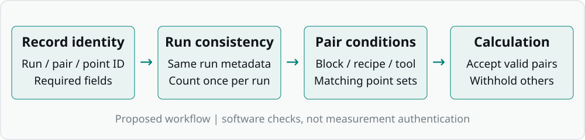

# 01 My role and the follow-up project

## Supervised manufacturing support

I completed a one-month manufacturing technology internship at an OLED deposition-equipment manufacturer. I began by helping with factory tasks and then joined practical work under my supervisor's direction.

## My contribution after the internship

I supplied the account of my internship and set the goal of connecting it with engineering and AI in a separate report and portfolio. I used AI tools to develop the supporting documents and software, and directed revisions to their presentation. I supplied a reference design and asked for a clearer explanation of my role alongside the technical results.

| Part of the work | My contribution | Supporting material |
|---|---|---|
| Internship | Assisted with factory work and carried out tasks under supervision | Internship account |
| Project purpose | Provided the manufacturing context and requested an engineering-and-AI follow-up | Record-validation project and separate 4M analysis |
| Development and revision | Used AI tools for documents, code and checks; directed revisions to the report's scope and presentation | Design files, executable code, test outputs and reports |

AI tools drafted the technical design, implemented the code and ran automated checks. The following chapters describe the rules and results developed through that process.

## What the project produced

The main deliverable is a record-validation tool, supported by a checklist, a proposed paired comparison and an analysis workbook. The design uses a carrier, the supporting fixture, and a witness coupon, a sample used to assess a deposited film. Their identities, preparation conditions and measurement points stay connected in the proposed record.

The follow-up work was completed after the internship. Its results concern software behaviour and a separate synthetic-data classification exercise. The package contains no field A/B observations, and the record schema is a proposed design rather than a company-approved specification.

# 02 The record is part of the engineering design

## Choose a change that can be specified

A contact stop could constrain sample placement, but specifying one would require actual equipment dimensions, permitted contact surfaces, contamination requirements and clearance checks. The project therefore specifies a non-contact layout, checklist and matching rules using the information available.

The record contains 26 columns, including 25 required fields and optional notes. Each row identifies one measurement point within one method run. A pair ID connects an A run and a B run. Repeated run information must agree across the point-level rows.



Figure 1. Proposed record flow. The checks establish whether the inputs meet the comparison rules; they do not authenticate the origin of a measurement.

## Separate the two outcomes

The proposed A method uses the existing approved preparation procedure. B adds the checklist. Preparation errors are counted once per run. Film thickness is recorded at fixed points, and its range is the maximum minus the minimum across the same point set.

An omitted preparation check and a wider film-thickness range can occur together without establishing a causal relationship. Preparation errors and thickness ranges are therefore recorded separately.

| Design decision | Reason |
|---|---|
| Match block, recipe and measurement tool | Reduce differences in recorded comparison conditions |
| Require the same point set, with at least two points | Make the spatial ranges refer to the same sampling layout |
| Balance AB and BA order in the proposed trial | Allow order-related differences to be examined |
| Review repeated measurements separately | Examine measurement repeatability before pooling results |
| Keep missing values distinct from zero | Prevent absent observations from becoming numerical results |

# 03 Three cases that explain the validator

## A valid software fixture

The baseline fixture contains 12 constructed rows: an AB pair and a BA pair, each with three measurement points per method. Its TEST-prefixed IDs, fixed date of 2000-01-01 and thickness constants identify it as SOFTWARE_TEST input. The validator accepts two comparable pairs.

The [worked numerical example](validation_example.md) lists the point values and calculates the two range differences.

## Case 1: an incomplete recipe record

The `missing_recipe_id` test removes one required recipe value from a six-row fixture. The saved result includes `MISSING_FIELD`, and the accepted-pair count becomes zero. A numerical thickness value on that row cannot compensate for the missing comparison condition.

## Case 2: a different measurement-point set

The `measurement_point_mismatch` test changes a point identifier to P4. The saved result includes `POINT_SET`, and the pair is withheld. Equal numbers of measurements are insufficient when the measurements refer to different locations.

## Case 3: one error repeated across several rows

Preparation-error counts belong to a run, while thickness values belong to individual points. A constructed test repeats A's two preparation errors and B's one error across their three point rows. The validator reports two and one respectively. Summing every row would incorrectly produce six and three.

## What the test total establishes

All 55 configured cases passed: each contained the expected issue codes and produced the expected number of accepted pairs. The cases cover required-field omissions, invalid values, duplicate IDs, mismatched conditions, evidence categories and boundary inputs. The result verifies the specified behaviours. A general error-detection rate was not measured.

The saved evidence is in `outputs/software_validation/test_results.json` and `test_cases.csv`. Source hashes in the result file connect the test run to the validator and test script versions.

# 04 From validated records to model evaluation

## Connecting records to labels

The validator decides whether records meet declared rules for comparison. A classifier estimates a label from chosen features. Both require a defined unit of observation, consistent identifiers and clear timing.

The current 4M example is a separate synthetic dataset. Its human, machine, material and method fields are not populated from the carrier checklist. A future connection would require a run-level dataset with independently observed quality labels, an agreed prediction time and traceable joins between preparation records and outcomes.

## Read the errors before choosing a model

The pipeline generates 4,000 rows with 240 positive labels. A stratified 75/25 split produces 3,000 training rows and 1,000 evaluation rows. The evaluation set contains 60 positives and 940 negatives. The seed is 42 and the decision threshold is 0.5.

| Model | Positives found / 60 | False alarms / 940 | Recall | Precision |
|---|---|---|---|---|
| LogisticRegression | 50 | 119 | 83.3% | 29.6% |
| LightGBM | 26 | 29 | 43.3% | 47.3% |

At this threshold, LogisticRegression finds 24 more positives and produces 90 more false alarms. LightGBM misses 34 positives; LogisticRegression misses 10. Choosing a model requires the relative costs of a missed defect and an unnecessary inspection. These outputs alone do not establish either model as the preferred production system.

## What changes for a real prediction task

The generated label uses lot, shift, rework, waiting time and noise. Some of these variables also appear as inputs, and rework may only be known after the outcome of interest. The exercise therefore evaluates classification of generated, completed-work records. Future-defect prediction would require features available at the prediction time and labels collected independently. Evaluation by time or lot would also be needed to examine performance on future work or unseen groups.

# 05 Evidence and the next engineering step

## Completed outputs

This GitHub export provides the proposed record structure, a comparison plan, the CSV validator and the synthetic-data classification pipeline. The original portfolio workbook is omitted from this export. Software-test fixtures and model evaluation outputs accompany the code.

The workbook was previously checked through 47 recalculation assertions in Artifact Tool, including statistics and invalid-input handling. Four Streamlit AppTest scenarios checked dashboard filters and sample conditions. These checks did not cover native Excel behaviour or a browser layout review.

## A field trial would test a different claim

The next engineering step is a supervised trial of the proposed checklist. It requires review of equipment and contamination constraints, a measurement-repeatability check, matched A/B conditions and recorded order and block information. Measurement time, instrument and calibration information, reviewer identity, corrections and excluded runs need to remain traceable in the source record.

The trial would assess preparation errors and thickness-range differences. The completed software tests check specified input conditions and calculations; field effectiveness still requires measurement.

## Reproduce the core result

```bash
python code/verify_records.py --out outputs/software_validation
python code/record_validation.py templates/field_records.csv
python code/pipeline.py --n 4000 --defect-rate 0.06 --seed 42 --out outputs
streamlit run code/app/dashboard.py
```

The validator and its test script use Python's standard library. The model pipeline and dashboard require `code/requirements.txt`. The execution environment for the saved model outputs is recorded in `outputs/run_metadata.json`. The field CSV is a blank template and should return EMPTY before observations are entered.

# References and supporting files

## Evidence index

- [Software-test results](../outputs/software_validation/test_results.json): case-level outcomes and source hashes.
- [Constructed test inputs](../outputs/software_validation/test_cases.csv): SOFTWARE_TEST fixtures.
- [Model results](../outputs/results.csv) and [execution metadata](../outputs/run_metadata.json): confusion matrices and run conditions.
- [Detailed comparison plan](comparison_plan.md): Korean technical supporting document.
- [Checklist](checklist.md) and workbook (omitted from this GitHub export): proposed recording and calculation tools.
- [OLED literature notes](literature_notes.md): published context, separate from company measurements.

## Measurement references

The range definition follows [NIST Measures of Scale](https://www.itl.nist.gov/div898/handbook/eda/section3/eda356.htm). Measurement-repeatability terminology is discussed in [NIST TN 1297, Appendix D.1](https://www.nist.gov/pml/nist-technical-note-1297/nist-tn-1297-appendix-d1-terminology).

The OLED literature notes include [Yun et al., 2016](https://doi.org/10.1038/srep34150) and [Lee et al., 2024](https://doi.org/10.3390/mi15010146). Their specimen-specific values provide literature context, not company acceptance limits or evidence of this checklist's effects.
