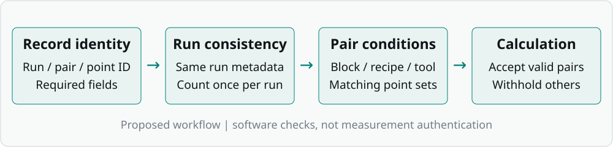

# Manufacturing records for consistent comparisons

## Mintech internship and follow-up engineering project

I spent one month as a manufacturing technology intern at Mintech. I supported factory tasks and OLED deposition-equipment manufacturing under my supervisor's direction.

## The follow-up project

The project develops a proposed carrier and witness-coupon record structure, a preparation checklist, a paired comparison plan, a workbook and a Python CSV validator. The goal is to define what must be recorded before two preparation methods can be compared.

The record links each measurement point to a method run, carrier, coupon, preparation conditions and comparison block. This structure keeps point-level measurements connected to run-level conditions and preparation-error counts.

# 01 The record is part of the engineering design

## Choose a change that can be specified

A contact stop could constrain sample placement, but specifying one would require equipment dimensions, permitted contact surfaces, contamination requirements and clearance checks. The project therefore specifies a non-contact layout, checklist and matching rules using the information available.

The proposed record contains 26 columns, including 25 required fields and optional notes. Each row identifies one measurement point within one method run. A pair ID connects an A run and a B run. Repeated run information must agree across the point-level rows.

Figure 1. Proposed record flow. The checks establish whether the inputs meet the comparison rules; they do not authenticate the origin of a measurement.

## Separate the two outcomes

The proposed A method uses the existing approved preparation procedure. B adds the checklist. Preparation errors are counted once per run. Film thickness is recorded at fixed points, and its range is the maximum minus the minimum across the same point set.

An omitted preparation check and a wider film-thickness range can occur together without establishing a causal relationship. Preparation errors and thickness ranges are therefore recorded separately.

| Design decision | Reason |
|---|---|
| Match block, recipe and measurement tool | Keep comparison conditions aligned |
| Require the same point set, with at least two points | Make the spatial ranges refer to the same sampling layout |
| Balance AB and BA order in the proposed trial | Allow order-related differences to be examined |
| Review repeated measurements separately | Examine measurement repeatability before pooling results |
| Keep missing values distinct from zero | Prevent absent observations from becoming numerical results |

# 02 How the validator handles records

The validator checks whether required fields are present, values follow the declared format, run-level fields are consistent, and paired runs use matching conditions and measurement-point sets. A pair that fails these rules is withheld from calculation.

For example, equal numbers of measurements do not make two runs comparable when their point identifiers differ. Preparation-error counts belong to a run, while thickness values belong to individual measurement points, so a run-level count is not added once for every point row.

These rules define how the software handles submitted records. They do not show that a checklist reduces preparation errors or changes film-thickness variation.

## Evidence and the next engineering step

## Proposed outputs

The project provides a proposed record structure, checklist, paired comparison plan, workbook and CSV validator. The field-record template is blank. The documents do not report field A/B observations or company-approved specifications.

## A field trial would test a different claim

The next engineering step is a supervised trial of the proposed checklist. It requires review of equipment and contamination constraints, a measurement-repeatability check, matched A/B conditions and recorded order and block information. Measurement time, instrument and calibration information, reviewer identity, corrections and excluded runs need to remain traceable in the source record.

The trial would assess preparation errors and thickness-range differences. Any conclusion about field effectiveness would depend on those observations and the measurement conditions.

## Supporting files

- [Detailed comparison plan](comparison_plan.md): proposed A/B conditions and measurement rules.
- [Checklist](checklist.md) and [workbook](../workbooks/carrier_coupon_comparison.xlsx): proposed recording and calculation tools.
- [Record validator](../code/record_validation.py): checks the declared CSV rules.

## Measurement references

The range definition follows [NIST Measures of Scale](https://www.itl.nist.gov/div898/handbook/eda/section3/eda356.htm). Measurement-repeatability terminology is discussed in [NIST TN 1297, Appendix D.1](https://www.nist.gov/pml/nist-technical-note-1297/nist-tn-1297-appendix-d1-terminology).

The OLED literature notes include [Yun et al., 2016](https://doi.org/10.1038/srep34150) and [Lee et al., 2024](https://doi.org/10.3390/mi15010146). Their specimen-specific values provide literature context, not company acceptance limits or evidence of this checklist's effects.
