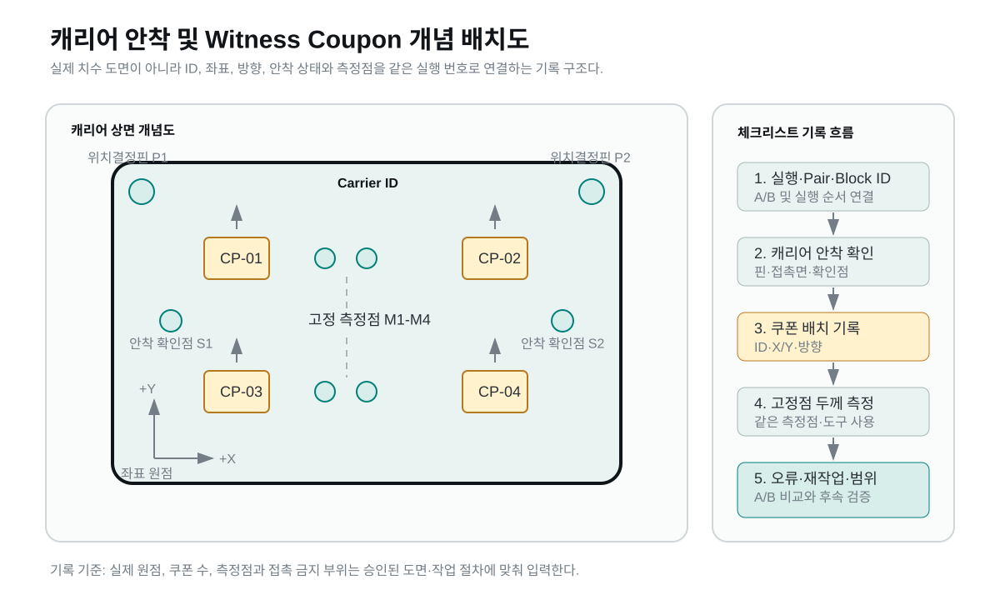

# 이 보고서에 대해

민테크 제조기술 부서에서 OLED 증착장비 제조 지원 인턴으로 근무했다. 처음에는 공장 업무를 도왔고, 이후 사수를 따라 실무에 참여하며 지시받은 일을 수행했다. 이 보고서는 그 경험에서 출발한 후속 프로젝트를 설명한다. 중심 결과물은 비교할 수 있는 기록을 가려내는 Python 검증 도구이며, 체크리스트와 비교설계, 분석 워크북이 이를 뒷받침한다.

후속 과제에서는 실행마다 준비 조건과 측정값을 어떻게 기록해야 두 결과를 비교할 수 있는지 살폈다. 캐리어와 witness coupon의 식별, 배치, 측정점을 연결하는 양식을 만들고, 빠진 정보나 맞지 않는 조건이 있을 때 계산을 보류하도록 검사 코드를 구성했다.

이 문서의 현장 역할은 제조 지원이고, 후속 설계와 코드는 인턴십 이후의 작업이다. 문서 초안, 코드 구현, 편집과 검증에는 AI 도구를 사용했다. 실행 결과는 소프트웨어 시험과 별도 합성 데이터 분석이며, 현장 A/B 관찰값은 포함하지 않는다.

영어 자료는 [2쪽 요약본](project_brief.md)과 [상세 보고서](engineering_report.md)로 나눴다. 이 한국어 문서는 세부 내용을 확인하는 원문이다.

# 01 내가 맡은 일과 프로젝트 진행

## 현장에서는 감독 아래 제조 업무를 지원했다

한 달 동안 민테크 제조기술 부서에서 인턴으로 근무했다. 공식 담당업무는 OLED 증착장비 제조 지원이다. 처음에는 공장 업무를 도왔고, 이후 사수를 따라 실무에 참여하며 지시받은 작업을 수행했다.

## 인턴십 이후에는 작업의 목표와 수정 방향을 정했다

후속 작업에서는 이 제조 지원 경험을 엔지니어링과 AI에 연결해 별도 보고서와 포트폴리오로 정리한다는 목표를 정했다. 내가 경험한 업무의 범위를 설명하고, AI 도구를 활용해 설계 문서와 분석 도구를 구성하도록 작업을 요청했다. 보고서의 참고 디자인을 제시했고, 수정 과정에서는 기술 설명 속에서 내 역할이 드러나도록 방향을 조정했다.

| 작업 | 내가 맡은 부분 | 연결되는 자료 |
|---|---|---|
| 현장 제조 지원 | 공장 업무를 보조하고 사수의 지시에 따라 실무 수행 | 인턴십 경험 설명 |
| 후속 작업의 목표 | 제조 경험을 엔지니어링 및 AI와 연결한 보고서로 정리하도록 목표와 요구 제시 | 기록 검증을 중심으로 한 프로젝트 구성 |
| AI 도구 활용 | 설계 문서, 코드와 분석 자료의 작성을 요청하고 수정 방향 제시 | 배치도, 체크리스트, 검증 코드와 평가 출력 |
| 결과물 전달 | 참고 디자인과 보충자료 용도를 제시하고 역할 설명을 구체화하도록 수정 요청 | 영어 요약본과 상세 보고서 |

기술 설계의 초안, 코드 구현과 자동 검사는 AI 도구를 활용해 진행했다. 아래 장에서는 그 과정에서 구체화한 설계 규칙과 실행 결과를 설명한다.

## 후속 설계가 다룬 문제

캐리어와 witness coupon의 식별 정보, 좌표, 방향과 측정점을 한 실행 ID로 묶었다. 이 구조로 누락된 정보를 확인하고 비교할 두 실행을 고르는 기준을 만들었다. 준비 조건과 측정값을 연결하는 기록 양식, 비교 조건을 검사하는 코드와 별도 4M 분석 예제가 후속 작업의 결과물이다.

# 02 비교할 수 있는 기록 만들기

> 준비 조건과 측정점이 함께 남아야 두 실행을 비교할 수 있다.

기록의 기본 단위는 한 방법의 실행과 한 측정점이다. 실행 ID에 캐리어와 쿠폰의 식별 정보, 배치와 측정 조건을 연결했다. 두 방법을 비교할 때는 같은 쌍 ID를 사용한다.



그림 1. 캐리어, 쿠폰과 측정점의 관계를 보여 주는 개념도. 실제 장비 치수나 승인 도면을 대신하지 않는다.

식별 정보는 다른 실행의 기록이 섞였는지 확인할 때 사용한다. 안착 확인과 좌표 및 방향은 준비 누락을, 레시피와 측정 도구는 조건의 일치를, 고정 측정점은 비교할 지점 집합의 일치를 확인하는 기준이다. 세부 항목은 별도 체크리스트와 기록 양식에 남겼다.

## 장비를 바꾸는 안과 기록을 바꾸는 안

문서상 대안으로 접촉식 스토퍼와 비접촉 기록 방식을 비교했다. 스토퍼를 추가하려면 실제 장비의 치수, 접촉 허용 부위, 오염과 장착 간섭을 확인해야 한다. 현재 확보한 정보로 구현할 수 있는 범위는 준비 정보를 연결하는 배치도와 체크리스트였다.

확보한 정보에 맞춰 기록 항목과 검증 규칙을 명세했다.

# 03 A와 B를 비교하는 방법

## 준비 오류와 두께 범위를 따로 읽는다

현장에서 승인된 기존 준비 절차를 A, 추가 체크리스트를 사용하는 절차를 B로 정의한다. 캐리어와 쿠폰을 준비할 때 빠진 항목이 줄어드는지 먼저 보고, 같은 고정 측정점의 두께 범위가 어떻게 달라지는지 함께 기록하는 설계다.

준비 오류가 줄었다고 해서 박막 품질도 좋아졌다고 결론 내릴 수는 없다. 두께는 공정의 시간 경과, 장비 상태와 측정 변동의 영향을 함께 받는다. 두 결과를 한 개선율로 합치지 않았다.

| 비교 항목 | 방법 | 해석할 때 확인할 조건 |
|---|---|---|
| 준비 오류 | 오류가 발생한 실행과 오류 유형을 기록 | 수정한 오류도 이력 보존 |
| 두께 범위 | 같은 고정점 집합의 최댓값에서 최솟값을 뺌 | 지점 수와 제외 지점이 같은가 |
| 실행 순서 | AB와 BA를 균형 있게 배치하고 실제 순서 기록 | 먼저 수행한 방법에 차이가 몰리는가 |
| 블록 | 날짜, 작업 구간과 장비 상태를 구분 | 조건이 달라진 실행을 합치지 않았는가 |
| 반복 측정 | 같은 대상과 지점을 반복 측정 | 측정 변동이 방법 차이보다 큰가 |

## 계산을 보류하는 조건

입력값이 비었거나 쌍의 조건이 맞지 않으면 두께 범위 차이를 계산하지 않는다. 0은 실제 입력값이 0일 때만 사용한다. 중단하거나 제외한 실행도 삭제하지 않고 사유를 남긴다.

같은 지점을 반복 측정한 자료는 처음 측정한 자료와 바로 합치지 않는다. 먼저 반복성을 따로 확인해야 하기 때문이다. 실측 후 통계 검정을 사용할 때에도 쌍의 독립성, 차이의 분포와 이상치를 함께 검토해야 한다.

현장 시험을 실행할 때는 이 설계를 승인된 작업 절차와 실제 측정 조건에 맞춰 구체화한다.

# 04 기록 검증 코드를 실행하다

## 정상 입력에서 한 조건씩 바꿨다

기록 누락과 비교 조건 불일치를 확인하도록 Python 표준 라이브러리로 CSV 검증 도구를 구성했다. 정상 AB와 BA 입력을 만든 뒤 누락, 중복, 잘못된 값과 비교 조건의 불일치를 하나씩 넣었다.

기본 시험 입력은 방법별 3개 측정점, AB와 BA 각 한 쌍으로 구성한 12행이다. 날짜 2000-01-01, TEST로 시작하는 ID와 두께 값은 프로그램에서 정한 시험 상수다. 자료 구분은 SOFTWARE_TEST다.

시험은 필수 정보 누락, 식별 및 수치 오류, 비교 조건 불일치, 자료 범주 혼입과 경계 입력을 다뤘다. 전체 목록은 별도 검증 결과 문서에 정리했다.

55개 시험 모두 기대한 오류 코드가 결과에 포함됐고 유효 쌍 수가 예상값과 일치했다. 이 결과는 구성한 시험 목록의 동작을 확인한 것이다.

## 값이 있어도 계산할 수 없는 두 사례

`missing_recipe_id` 시험은 6행의 시험 입력에서 필수 레시피 값 하나를 비웠다. 결과에는 `MISSING_FIELD`가 포함됐고 유효 쌍 수는 0이 됐다. 두께 값이 있더라도 비교 조건이 빠져 있으면 계산을 보류한다.

`measurement_point_mismatch` 시험은 한 측정점 이름을 P4로 바꿨다. A와 B의 측정 개수가 같아도 지점 집합은 달라진다. 결과에는 `POINT_SET`이 포함됐고 해당 쌍의 계산을 보류했다. 측정 개수와 위치를 각각 확인하도록 만든 규칙이다.

## 오류 건수를 측정점 수만큼 세지 않는다

오류 건수는 실행 단위 값이고 두께는 측정점 단위 값이다. 한 실행에 측정점이 세 개 있다고 해서 준비 오류도 세 번 더하면 안 된다. 시험에서는 A의 준비 오류 2건, B의 1건을 각 측정점에 반복 기록하고 실행당 한 번만 집계되는지 확인했다.

## 엑셀과 대시보드도 입력을 바꿔 확인했다

엑셀은 Artifact Tool에서 재계산하며 통계와 입력 처리 47개 검사를 실행했다. 쌍체 평균과 표준편차, t값과 신뢰구간을 별도 계산과 대조하고, 문자 입력이 수식 오류로 숨지 않는지 확인했다. 대시보드는 Streamlit AppTest에서 필터와 표본 조건을 바꾸는 네 동작을 확인했다. 네이티브 Excel과 브라우저 화면 배치는 이 검사에 포함하지 않았다. 시험 입력은 실측 영역에 남기지 않았다.

# 05 4M 데이터로 분류를 구성하다

## 무엇을 입력으로 삼았는가

기록을 데이터 분석으로 확장하는 별도 예제로 사람, 설비, 자재와 방법의 4M 구조를 사용했다. 작업자, 설비, 자재 로트와 작업 코드에 활동시간, 대기시간, 재시도와 재작업 항목을 더했다.

데이터 4,000행은 코드로 생성했다. 결함 라벨도 로트, 교대, 재작업, 대기시간과 잡음으로 정한 점수에서 부여했다. 전체 양성은 240행이다. 75/25 층화 분할로 학습 3,000행과 평가 1,000행을 나눴고 평가셋의 양성은 60행, 음성은 940행이다. seed는 42, 분류 임계값은 0.5다.

## 같은 평가셋에서도 오류의 종류가 달랐다

| 모델 | 양성 검출 / 60건 | 음성 오분류 / 940건 | 재현율 | 정밀도 |
|---|---|---|---|---|
| LogisticRegression | 50 | 119 | 83.3% | 29.6% |
| LightGBM | 26 | 29 | 43.3% | 47.3% |

LogisticRegression은 양성을 더 많이 찾았지만 음성을 양성으로 분류하는 경우도 많았다. LightGBM은 오경보가 적은 대신 놓친 양성이 더 많았다. 어느 모델을 선택할지는 놓침과 오경보 중 어떤 비용을 줄이려는지에 달려 있다.

이 예제는 생성 규칙을 학습하는 작업 완료 후 분류다. 재작업과 시간 변수는 라벨 생성에도 사용되므로 독립적으로 관찰한 현장 결함을 예측한 결과로 볼 수 없다. 같은 작업자나 로트가 학습셋과 평가셋에 함께 나타날 수 있어 미래 기간이나 새 로트의 성능도 확인하지 않았다.

## 체크리스트와 모델을 연결하려면

현재 체크리스트의 실측 기록이 모델에 자동으로 들어가지는 않는다. 검증 도구는 정해진 비교 규칙을 만족하는지 판정하고, 분류 모델은 선택한 입력으로 라벨을 추정한다. 두 도구를 연결하려면 측정점별 기록을 실행 단위로 정리하고, 독립적인 품질 판정과 연결해야 한다. 수집 권한과 예측 시점도 먼저 정해야 한다. 그다음 시간이나 로트로 평가셋을 나누고, 오류 비용에 맞춰 임계값을 정해야 한다.

# 06 현재 결과와 다음 측정

## 지금 남긴 것은 실행 가능한 기록 구조다

배치도와 체크리스트에는 어떤 정보를 남길지, 비교설계에는 어떤 실행을 묶을지 정리했다. CSV 검증 도구는 누락과 조건 불일치를 검사하고, 엑셀은 유효한 쌍의 범위와 차이를 계산한다. 4M 분석 코드는 데이터 생성부터 평가 결과 저장까지 재현할 수 있다.

| 확인한 결과 | 근거 파일 |
|---|---|
| 기록 검증 시험 55개 통과 | `outputs/software_validation/test_results.json` |
| 구성한 시험 입력과 소스 해시 | `outputs/software_validation/test_cases.csv`, 결과 JSON |
| 빈 현장 입력의 EMPTY 처리 | `outputs/software_validation/field_input_check.json` |
| 4M 모델의 평가 결과와 실행 조건 | `outputs/results.csv`, `outputs/run_metadata.json` |

## 현장 효과는 별도 측정으로 확인한다

체크리스트가 준비 오류를 줄이는지, 두께 범위에 차이가 생기는지는 아직 측정하지 않았다. 다음 현장 시험에서는 담당 엔지니어가 절차와 접촉 및 오염 조건을 먼저 검토해야 한다. 측정 반복성을 확인한 뒤 같은 조건의 A와 B를 배치하고 실제 순서와 블록을 기록한다.

원자료에는 측정 시각, 확인자, 장비와 교정 정보가 연결돼야 한다. 제외한 실행과 수정한 오류도 남겨야 한다. 이 조건이 갖춰진 자료로 준비 오류와 두께 범위를 분석하고, 측정 변동이나 시간 경과로 설명되는 차이를 따로 검토한다.

현재의 검증 도구와 양식은 승인된 현장 시험에서 자료를 수집하고 비교하는 출발점으로 사용할 수 있다. 현장 효과를 평가하려면 이 조건에 맞는 원자료를 별도로 확보해야 한다.

# 자료와 재현 경로

## 세부 설계와 원출력

- [엔지니어링 리포트](engineering_notes_ko.md): 활동 범위와 후속 설계.
- [A/B 비교설계](comparison_plan.md): 입력과 통제 조건, 역할 및 해석 기준.
- [기록 검증 실행 결과](software_validation.md): 시험 범주와 재현 방법.
- [4M 코드 설명](code_notes.md): 생성 라벨, 변수, 평가 지표와 환경.
- [OLED 박막 문헌 자료](literature_notes.md): 연구별 조건과 물성값. 현장 데이터나 회사 합격 기준으로 사용하지 않았다.

## 실행 명령

기록 검증 코드는 Python 표준 라이브러리만 사용한다. 4M 분석과 대시보드는 `code/requirements.txt`의 패키지가 필요하다.

```bash
python code/verify_records.py --out outputs/software_validation
python code/record_validation.py templates/field_records.csv
python code/pipeline.py --n 4000 --defect-rate 0.06 --seed 42 --out outputs
streamlit run code/app/dashboard.py
```

## 계측과 문헌의 참고 범위

범위와 표준편차의 정의는 [NIST Measures of Scale](https://www.itl.nist.gov/div898/handbook/eda/section3/eda356.htm), 반복성의 용어는 [NIST TN 1297](https://www.nist.gov/pml/nist-technical-note-1297/nist-tn-1297-appendix-d1-terminology)을 참고했다.

문헌에서 본 전극 재료와 적층 구조의 값은 연구별 조건이 달랐다. [Yun et al., 2016](https://doi.org/10.1038/srep34150)과 [Lee et al., 2024](https://doi.org/10.3390/mi15010146)의 수치도 서로 다른 시편의 맥락 자료로 정리했다. 이를 캐리어 준비의 효과나 민테크의 측정값으로 옮기지 않았다.
